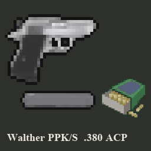

# Walther PPK/S for Project Zomboid (Build 42)



The civilian concealed-carry pistol a 1993 Kentucky household would own, with its own scarce .380 ACP ammo. Build 42 only. Mod ID: `WaltherPPKS`.

## What it adds

- **Walther PPK/S** (.380 ACP, 7-round magazine). Damage 0.6–1.0, the same as the M9, but with a shorter range (10), fewer rounds (7 vs 15), lighter weight (1.0 vs 1.5) and M1911-level noise (radius 70). Everything else follows the vanilla M9. Vanilla unsuppressed pistol sounds and custom suppressed shot sound.
- **.380 ACP rounds, boxes of 50** (with their own green box art) and **PPK/S magazines**. Open a box into 50 rounds, or pack 50 rounds into a box. No carton.
- **Walther PPK/S Suppressor** A rare barrel attachment for the PPK/S only: attach and remove it through the vanilla attachment menu, no tool needed. While it's on, each shot plays a suppressed shot sound and the gun's sound radius drops from 70 to 10. It never wears out and can't be crafted.

## Loot

Civilian loot only: homes, gun stores, pawn shops, cars and stashes.

- The PPK/S spawns at 75% of the M9's chance.
- Every .380 item spawns at half the chance of the matching 9mm item.
- Nothing from this mod spawns in police, military, SWAT, security, prison-guard or sheriff loot, or on zombies.
- Every looted PPK/S comes with a magazine.
- The suppressor is as rare as the vanilla x8 scope (fixed copies of its weights), in gun stores, hunting and outdoor-supply stores, pawn shops, garages and civilian firearm stashes only; never in SWAT or army storage.

## For modders

The ammo is registered as `waltherppks:bullets_380` (item `WaltherPPKS.Bullets380`). Other .380 guns can use it with `AmmoType = waltherppks:bullets_380` without changing this mod's ammo.

## Repository layout

| Path | What it is |
|---|---|
| `workshop/WaltherPPKS/` | The Workshop upload folder: `workshop.txt`, `preview.png`, and the mod in `Contents/mods/WaltherPPKS/` |
| `dev/WaltherPPKS_TestGun380/` | Dev-only test mod, never shipped: a throwaway .380 gun plus automatic checks |
| `tools/build_model.py` | Blender script: turns `assets/source/walther_ppk.glb` into the in-game gun and suppressor models, texture and icons |
| `tools/build_box_art.py` | Builds the .380 box texture and icon, mod icon, poster and preview from vanilla art (needs Pillow) |
| `tools/run_server_test.ps1` | Starts a headless dedicated server with the mod and test mod, and exits non-zero unless every check passes |
| `assets/source/` | Source model (CC BY 4.0, see Credits) |
| `_bmad-output/` | Planning notes and the build spec |

## Building and testing

1. **Model** (only needed after changing the source model). Run `blender -b --factory-startup --python tools/build_model.py` (tested with Blender 5.2). Optional arguments go after `--`, for example `-- --target-verts 1000`.
2. **Box art and listing images.** Run `python tools/build_box_art.py`. Run it after the model step, because the listing images use the gun icon.
3. **Headless check.** Run the command below. It copies both mods into `~/Zomboid/mods` for the run and removes them afterwards.

   ```powershell
   powershell -ExecutionPolicy Bypass -File tools/run_server_test.ps1
   ```

To play-test in the game, link `workshop/WaltherPPKS` into `~/Zomboid/Workshop/` and enable "Walther PPK/S" in the mod list. The dedicated server doesn't load mod translations, so check display names in the game.

## Credits

- **Gun and suppressor models:** "Walther PPK" by MihaM ([Sketchfab](https://sketchfab.com/3d-models/walther-ppk-8595399f2c9141f4afeb8d138856a470)), licensed under [CC BY 4.0](https://creativecommons.org/licenses/by/4.0/). Changes for this mod: suppressor split off into its own model, polygon count reduced, textures resized and re-baked for Project Zomboid, icons rendered from the models.
- **Box art:** the .380 box texture and icon are edited from Project Zomboid's 9mm box art, used under the Project Zomboid Modding Policy.
- **Vanilla art and sounds:** rounds, magazine and sounds reuse vanilla art and audio, except the suppressed shot.
- **Suppressed shot sound:** `suppressed_pistol_shot.ogg`, supplied by the mod author.

This is a free fan mod that requires Project Zomboid. It is not official and not affiliated with The Indie Stone or Walther. See [CREDITS.md](CREDITS.md).

## License

The code, scripts, tools and docs are under the [MIT License](LICENSE). The gun and suppressor models and everything made from them stay under CC BY 4.0. The box art edited from vanilla stays under the Project Zomboid Modding Policy.
